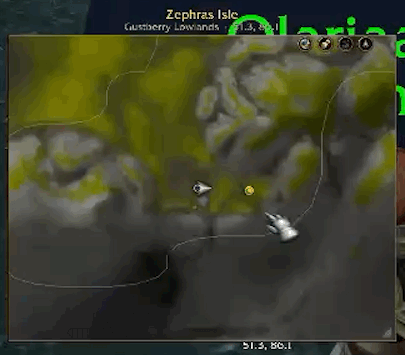
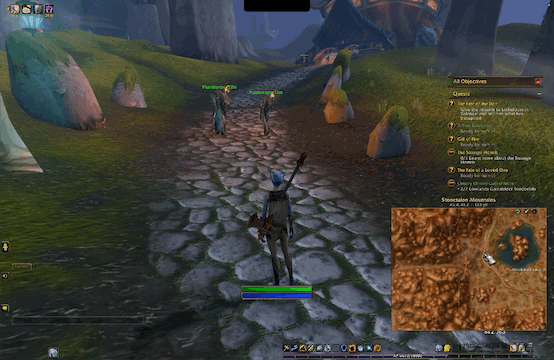

# MagicMap

A minimap you can zoom out. MagicMap takes your minimap's spot and draws the game's own minimap
terrain at any zoom, from Blizzard's closest zoom out to a whole continent. Blizzard's live blips
(herbs, ore, tracked NPCs) stay on it, and inside buildings it shows Blizzard's indoor maps. Press
M and it grows into a big map in the same frame.

For **WoW Forever** only. Version **2.0.0-rc.1**, the first release candidate of 2.0: a rebuild
of 1.0 (release notes: [dist/RELEASE_NOTES-v2.0.0-rc.1.md](dist/RELEASE_NOTES-v2.0.0-rc.1.md)).

## Features

**The minimap.** It sits square on your minimap's spot, about 200 yards across, in a metal frame
whose buttons show while you hover. The wheel or + / − zoom it, every notch a step, and the reset
button above + (shown while you're off the default zoom) glides back to it; drag to pan, and left
alone for 6 seconds after a pan it glides back to you (Follow you, in Settings). Move it by the
zone name or the border (or Alt-drag the map), resize it by the corner (it keeps the yards across),
and `/mm reset` puts it back. `/mm`, the rim button or the addon compartment swaps it for
Blizzard's minimap, and back.

**The big map (M).** M or the red button grows it into a big map, centred on you; M, the button
or Escape shrinks it. The quest log (L) still opens Blizzard's map. Click the zone name to pick a
continent, another map or an instance; with several zones in view, hover one to light it and click
to fly there. `/mm map` and `/mm zone` do the same by name.

**The ground.** The game's minimap tiles at any zoom, as Blizzard drew them, on each map's own dark
water; zone and subzone names, and on the big map the zone borders traced from the terrain; your
arrow.

**Indoors.** In a building, Blizzard's own indoor minimap pictures, placed on our map over the
dimmed terrain: the rooms on your floor whole, the floors below faded and those above ghosted where
they overlap yours, the room you're in on top. Your pins, zoom and pan work as outdoors. **City
maps** (gear → Map, on): on the big map in a capital (Ironforge, Orgrimmar, Undercity...), every
building of the city at once, indoors or out, what's underground faded, with the city's own area
names (The Great Forge, the Cleft of Shadow...) among the subzone names.

**Blizzard's blips.** Outdoors Blizzard's Minimap stays out of sight and is read as a sensor:
herbs, ore, the mailbox and tracked NPCs within about 230 yards get a pin with Blizzard's tracking
icon and tooltip, at any zoom. Zoomed in to town scale, the town services you track show too, and
blips seen before (up to 5000 a continent). Blizzard's own flight, quest and POI tracking is
switched off while MagicMap draws those itself, and put back when it stops, even after a crash.

**Quests.** The quests in your log in Blizzard's icons, with their objective icon and count, in
their difficulty colour; quests to pick up; a tooltip with the quest's facts, mobs, items and who
to turn it in to. Objective areas are drawn as the game draws them, and hovering an area lights it.
Click a quest (or its area, zoomed in) to follow it: it becomes the game's tracked quest. The quest
line at the bottom left shows the quest you follow and its progress, else how many of your quests
are in this zone.

**Where to go.** Your target is your corpse while you're a ghost, else the quest you follow, else
your waypoint. A hand-inked line walks you to it around cliffs, lava and water, to a quest area's
nearest edge; off the map, a gold arrow on the edge points the way. Ctrl-click sets the game's
waypoint (Ctrl-right-click clears it), Shift-click opens chat with a `/way` line, and right-click
offers both. On the big map, right-click leads with what's there: zone, subzones, coordinates, level
range against yours, distance, quests, explored or not, and the landmarks nearby.

**Places and people.** Flight points, dungeon entrances, graveyards and points of interest; party and
raid members in class colours; rares you've seen, remembered for every character on your account;
the rares and treasures the game shows now; your corpse and waypoint.

**Crowded icons.** Where icons overlap they group into a small pill of up to three icons (`+N` for
the rest); click it for a grid of them all, each with its own tooltip and click (Settings: Group
overlapping icons; its tunables under Advanced).

**Other addons.** World-map pins added through HereBeDragons (Questie, HandyNotes...) show on the
map with their own icons, tooltips and clicks, each addon a row in the gear's Other addons; their
minimap pins (GatherMate...) show around you. Nothing is drawn twice.

**The gear menu** (by the zone name): the layers by group, each row with its icon and an "All" box
on top: Map (zone labels, zone borders, City maps), Quests, Places, Nearby (rares and treasures,
party and raid, then Blizzard's tracking types), Other addons. Then Use Blizzard's minimap and Reset
to defaults, then Settings: Follow you, Group overlapping icons, Minimap button, Reset window
position, Advanced (diagnostics, grouping, performance). Settings are account-wide.

## Install

1. Download the MagicMap zip from the GitHub release (`MagicMap-v2.0.0-rc.1…zip`).
2. Unzip it into `World of Warcraft/_classic_beta_/Interface/AddOns/` (WoW Forever's folder), so
   you have `Interface/AddOns/MagicMap/MagicMap.toc`, not `MagicMap/MagicMap/`. When updating,
   delete the old `MagicMap` folder first. (1.0 saved its settings and seen rares as `MagicMapDB`;
   2.0 starts fresh, and doesn't need the QuestieDB addon.)
3. Restart the game. A `/reload` isn't enough the first time: new files load only at startup.
4. At the character select, AddOns: MagicMap ticked. In game, `/mm help` lists the commands.

MagicMap takes your minimap's spot at once. Without its quest data (a build without
`Data/Quests.lua`), one chat line says so and the map runs on: quests show without their mobs
and items, and town services are plain gold dots, only within the sensor's reach.

### Play-testing: what to send back

A short guide for a play session is [docs/playtest-external.md](docs/playtest-external.md).
Anything odd: type `/mm mark <what you saw>` at once (it saves what the map was doing then), and a
screenshot (Print Screen) helps. At the end, `/reload` (or log out) so the game writes its file,
then send

    World of Warcraft/_classic_beta_/WTF/Account/<your account>/SavedVariables/MagicMap.lua

and any screenshots (`_classic_beta_/Screenshots/`). Nothing leaves your computer otherwise.

| Command (`/mm` or `/magicmap`) | Does |
| --- | --- |
| `/mm` | MagicMap or Blizzard's minimap |
| `/mm follow` | Follow you, or stop |
| `/mm map <name or id>`, `/mm zone <name>` | Show a map (alone: list them); fly to a zone |
| `/mm reset` | Back onto the minimap's spot, at its size |
| `/mm layers`, `/mm layer <name>` | What's drawn; show or hide one layer |
| `/mm icon` | The minimap button |
| `/mm mark <note>` | Note something for the bug report (saved at `/reload` or logout) |
| `/mm landmarks`, `/mm indoor`, `/mm blips` | Rares remembered; the building and room you're in; what the sensor knows |
| `/mm help` | Every command, the diagnostics too (`perf`, `errors`, `check`...) |

## Limits

- **WoW Forever only**, the client build `Data/` was generated from (a patch means regenerating).
- **Blizzard's blips** are sensed only within about 230 yards of you.
- **Indoors** only buildings with Blizzard's indoor minimap pictures get them; elsewhere the terrain.
- **Instances** that hide your position are shown whole, without the arrow, line or blips.
- **Rotate Minimap**: MagicMap stays north up, and other addons' minimap pins hide while it's on.
- **Other minimap addons** (SexyMap, square-minimap addons) may conflict. While FarmHud has the
  minimap, MagicMap leaves it to FarmHud.
- **enUS** names only; no routes beyond walking; no per-character profiles
  ([docs/v1-non-goals.md](docs/v1-non-goals.md)).

# Development

The rebuild's design is in [architecture.md](architecture.md); the addon (the repo root is the
addon root, `MagicMap.toc`), its folders, load order and the Runtime contract are in
[docs/structure.md](docs/structure.md). **Atlas** (`atlas/`) is the library of facts that hold
(tiles, borders, labels, walk grid, uiMaps, areas, places, interiors and the capitals' buildings,
NPCs / objects / items / quests, coordinates and camera maths), from data the offline tools generate (`Data/`, see
[docs/atlas-data.md](docs/atlas-data.md)).

## Setup

    python3 -m venv .venv && .venv/bin/pip install -r tools/requirements-dev.txt

## Regenerate data

Each generator reads a local install (see its docstring for options) and states the build
in its output's header. Run them in this order: gen_tilecolor and gen_interiors read Data/Tiles.lua, gen_questie
reads Data/UiMaps.lua from gen_world and gen_world's ItemIcons reads gen_questie's
Data/Items.lua (the data diet), so gen_world runs again after it; gen_labels reads Borders,
Places, Areas, UiMaps, Tiles and Walk, so it runs last. The rest are independent. gen_questie's
five files (Npcs, Objects, Items, Quests, BlipServices) come from QuestieDB and Questie, used under
their GPLv3 terms (NOTICE.md); they're committed like the rest.

    W="/Applications/World of Warcraft"
    .venv/bin/python tools/gen_tiles.py     local "$W" wow_classic_beta -o Data/Tiles.lua
    .venv/bin/python tools/gen_tilecolor.py local "$W" wow_classic_beta -o Data/TileColor.lua
    .venv/bin/python tools/gen_borders.py   local "$W" wow_classic_beta -o Data/Borders.lua
    .venv/bin/python tools/gen_walk.py      local "$W" wow_classic_beta -o Data/Walk.lua
    .venv/bin/python tools/gen_areagrid.py  local "$W" wow_classic_beta -o Data/AreaGrid.lua
    .venv/bin/python tools/gen_world.py     local "$W" wow_classic_beta -o Data   # UiMaps, Areas, Places, ItemIcons
    .venv/bin/python tools/gen_questie.py "$W/_classic_beta_/Interface/AddOns/QuestieDB"
    .venv/bin/python tools/gen_world.py     local "$W" wow_classic_beta -o Data   # again: ItemIcons for the items kept
    .venv/bin/python tools/gen_labels.py    -o Data/Labels.lua
    .venv/bin/python tools/gen_interiors.py local "$W" wow_classic_beta -o Data/Interiors.lua   # reads Data/Tiles.lua's maps

The demo's assets, after the above:

    .venv/bin/python demo/export_tiles.py   # demo/tiles/<inst>: tile WebPs (--inst N, --all); after gen_tiles
    .venv/bin/python tools/export_icons.py local "$W" wow_classic_beta   # demo/icons: the icons named in demo/index.html's GAME_ICON

## Install and try it in game

    .venv/bin/python tools/install.py      # into _classic_beta_ (WoW Forever); another flavor folder as argument

It writes the TOC from the folders' `files.txt` (`--toc`: only that), then copies the TOC, its
files and Textures/ into `Interface/AddOns/MagicMap`. That is 1.0's folder too: while 1.0 is there it stops,
and `--replace-spike` moves 1.0 to `MagicMap.spike-backup` first (its saved data isn't
read: docs/decisions/0007-v2-storage-names.md). Log in (it says when files are new to the client:
restart it, not `/reload`), then:

- `/mm help` lists the commands; the map sits on the Minimap's spot from login (`/mm` or
  the minimap button hides and shows it, M grows it into the big map, `/mm reset` puts it back)
- with the map shown, Blizzard's Minimap becomes an unseen sensor and its blips (mailboxes,
  herbs, services) are drawn on the map; `/mm minimap blizzard` gives it back, `/mm layer <name>`
  toggles a layer, `/mm record on|off` keeps the observations for Model replay tests
  (flow: docs/structure.md "One flow end to end")
- `/mm perf load`: Atlas's load cost (ms, KB) and time per step / event / timer / job
- `/mm errors`: errors caught so far (each is also printed once when it happens)

## Release

Set `## Version:` in `MagicMap.toc` (D7: 2.x.x), run every generator on the installed client (above;
the QuestieDB-derived five too) and `tools/check.sh`, commit, tag `v<version>`, then

    tools/package.sh v2.0.0-rc.1   # dist/MagicMap-v2.0.0-rc.1.zip

One zip of the committed tree, with LICENSE and NOTICE.md; it's unzipped into a scratch AddOns folder
and loaded in the sim from there (every TOC file present; 0 errors) or isn't written. It goes on the
GitHub release, with its notes: for the release candidate
[dist/RELEASE_NOTES-v2.0.0-rc.1.md](dist/RELEASE_NOTES-v2.0.0-rc.1.md) (2.0.0's own, for later:
[dist/RELEASE_NOTES-v2.0.0.md](dist/RELEASE_NOTES-v2.0.0.md), the listing in
[dist/listing-v2.0.0.md](dist/listing-v2.0.0.md)). Bringing this repo into `~/code/MagicMap`:
[docs/release/merge-plan.md](docs/release/merge-plan.md).

## Telemetry

Play, `/reload`, then read what the addon saved (sessions, errors with stacks, marks with
state and trace, screenshots matched to `/mm shot`, the validation log, client `Logs/` lines
that mention the addon, and other addons' errors while ours was loaded). The contract is [docs/telemetry.md](docs/telemetry.md).

    .venv/bin/python tools/telemetry.py                  # everything, newest first
    .venv/bin/python tools/telemetry.py --errors --full  # one section: --errors --marks --shots --validation --logs
    .venv/bin/python tools/telemetry.py --since 30 --json   # last 30 minutes (or an ISO time), as JSON

Options: `--wow` (or `MAGICMAP_WOW`), `--flavor` (default `_classic_beta_`), `--sv <file>`, `--trace N`.

## Test and lint

The tests include a headless smoke test: the TOC's files loaded in order on a simulated WoW
Forever client (`tools/tests/wowsim.lua`), logged in, ~60 frames and every `/mm` command,
with no Lua error expected; `tools/luacheck.py` over the TOC (globals, every file listed,
the TOC = what the folders' `files.txt` make: `tools/install.py --toc` writes it); and
`tools/lint_div.py`, no `/` that may divide by 0 (docs/structure.md "Rules"). luacheck runs as a
test (test_luacheck).

    tools/check.sh                                     # all three, as CI runs them (makes .venv if missing): before committing
    tools/check.sh --quick -k zoom                     # lint_div + the plain pass alone, pytest arguments passed on: while iterating
    PYTEST_XDIST_AUTO_NUM_WORKERS=4 tools/check.sh     # 4 workers in all (default: the CPUs), for several checks at once
    MM_CLOCK_SCALE=4 tools/check.sh                    # the sim's real clock 4x slow: the tests (counted clock) don't notice
    .venv/bin/python -m pytest tools/tests -q -p no:cacheprovider
    .venv/bin/python tools/luacheck.py                 # the TOC's files: globals, TOC, boundaries
    .venv/bin/python tools/lint_div.py                 # each / by a literal, a constant or a reason

`check.sh` runs the tests twice side by side (plain, and `MM_STRICT=1`), each spread over half the
CPUs by pytest-xdist, so every test boots its own Lua and writes only under its `tmp_path`
(`UPDATE_GOLDEN=1`: one pass after the other, the goldens rewritten by the first). `--quick -k X`
runs in one process (a few tests: workers cost more than they save); `--quick -n0 -s` shows the
tests' prints.

`tools/sim.py` drives the same simulated client (the tests boot through it) from Python or the
shell: `s = sim.boot(priced=True)`, then `s.blips([("Mailbox", 40, 20)])` (yards east and north of
where you log in), `s.slash("/mm toggle")`, `s.run(6)` (past login's 5 s grace: a grace's frames
aren't in perf's byState), `s.wheel(3)`, `s.drag(200, 0, 20)`, `s.walk(10, "east")`, `s.press("M")`,
`s.lua(code)` (sim and ns are locals), and read back
`s.perf()` (FrameStats: byState, alloc, ledger; per-name calls), `s.errors()`, `s.layers()`;
`s.T` is the replays' harness (tools/tests/harness.lua). From the shell, a script:

    .venv/bin/python tools/sim.py --priced --run 'blip Mailbox 40 20; slash /mm toggle; run 6; wheel 3; run 2; perf; layers'
    .venv/bin/python tools/sim.py --run 'run 1; lua local cam = ns.UI.Camera.cam
    return cam.zoom, cam.cx'                          # lua: the rest of the script, lines and ';' as is
    .venv/bin/python tools/sim.py --help              # the commands

CI (`.github/workflows/check.yml`) runs `tools/check.sh` on every push and PR.

## Boundaries

`tools/luacheck.py` enforces [architecture.md](architecture.md)'s Rules per folder: the
globals each may read (`BOUNDARIES`: sections of `tools/lua51_globals.txt` and
`tools/wow_globals.txt`) and the `ns.<System>`s it may use (`NS_RULES`, a static scan).
Also: `Runtime.On` only in game/ (Game registers game events) and `UI.View` only in
game/Apply.lua (`ONLY`); only a system's own folder sets its fields, but for the hooks it
declares (`HOOKS`: Runtime's `onError`, `onTrace`); named frames only from `FRAME_NAMES`.

| folder   | globals                                       | ns                                         |
|----------|-----------------------------------------------|--------------------------------------------|
| atlas/   | Lua 5.1 only                                  | Atlas, Data (its generated `ns.Data`)      |
| runtime/ | Lua 5.1 + `[lua]` `[runtime]`: frame, clocks | Runtime                                    |
| model/   | Lua 5.1 only                                  | Model, Atlas, Runtime                      |
| ui/      | Lua 5.1 + `[lua]` `[ui]`: widgets, input     | UI, Atlas, Runtime; Model's read API (`Known`, `Target`, `Route`, `you`, `hooked`, `Focus`); `Game.Command` (slash and saved data too) |
| game/    | all of it, and only it the SavedVariables     | Game, Atlas, Runtime; `UI.View` (game/Apply.lua), `Model.Observe` / `Load` / `SAVED` |
| game/parts/, game/commands/ | as game/                     | Game, Atlas, Runtime (no View, no Model: Observe and Apply have those) |

Known violations waiting on a contract are `BASELINE` in `tools/luacheck.py` (each with
its TODO); the check fails once one is gone, so the list only shrinks.

## Demo

Atlas on its own in a browser: the server runs Atlas in Lua (lupa) over its bundled data and
serves its answers as JSON; `demo/index.html` only draws them (Eastern Kingdoms: drag to pan, wheel to zoom, hover readout, zone fly-to,
walk-grid overlay).

    .venv/bin/python demo/server.py        # http://localhost:8000 (optional port argument)

## License

MagicMap is free software under the GNU General Public License, version 3 ([LICENSE](LICENSE)), the
licence Questie and QuestieDB extend to copies of their work. Its quest, NPC, object and item data is
derived from [QuestieDB](https://github.com/Questie/QuestieDB) and [Questie](https://github.com/Questie/Questie):
credits and terms in [NOTICE.md](NOTICE.md). MagicMap isn't affiliated with Questie or Blizzard.
