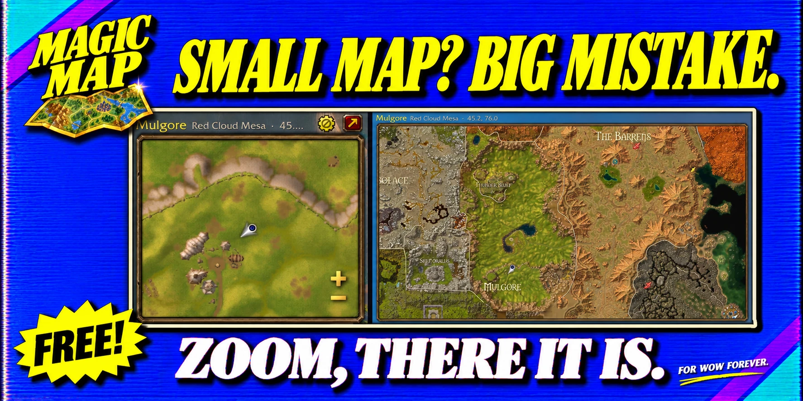
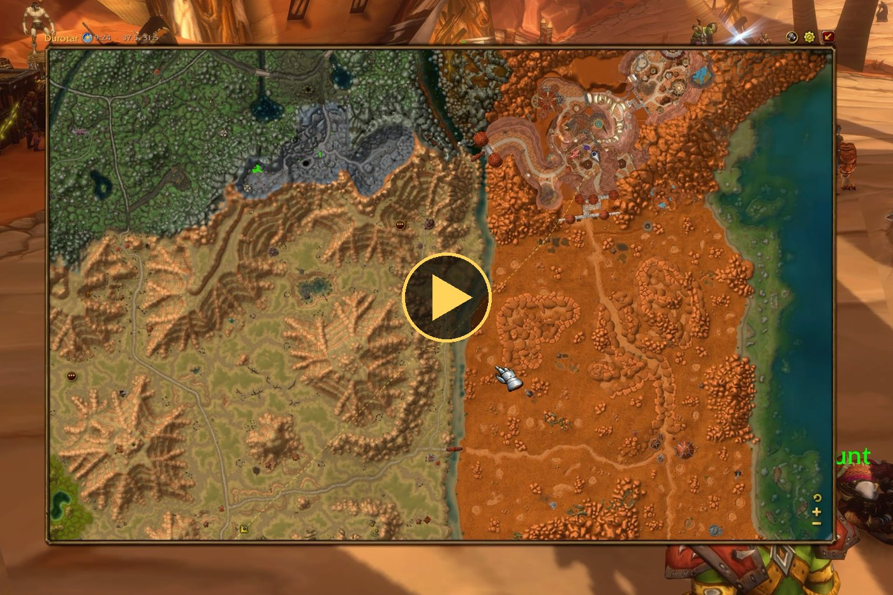
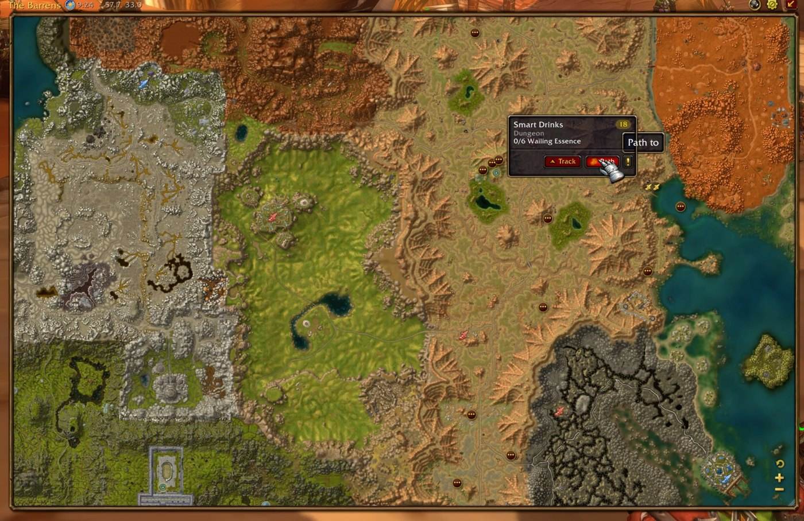
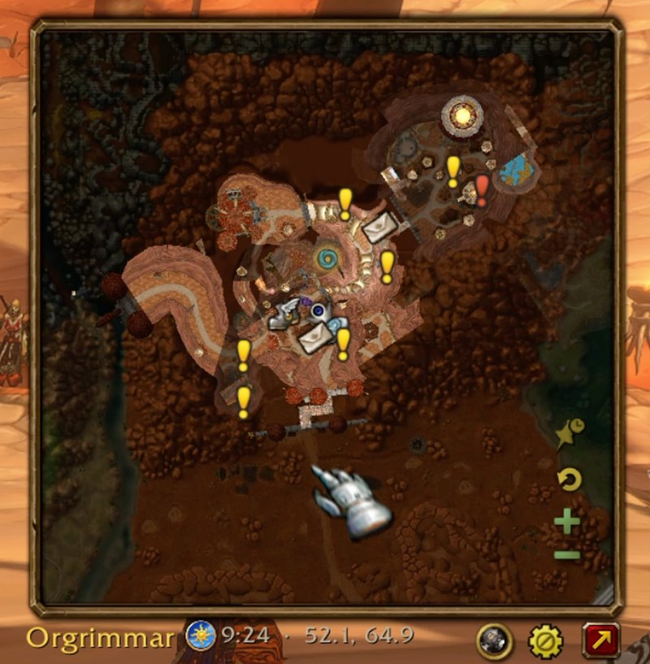
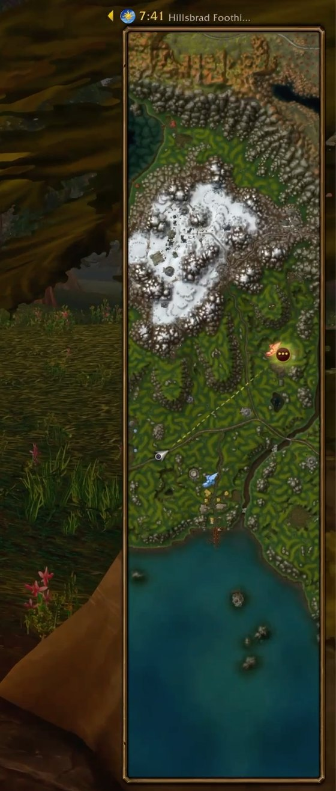
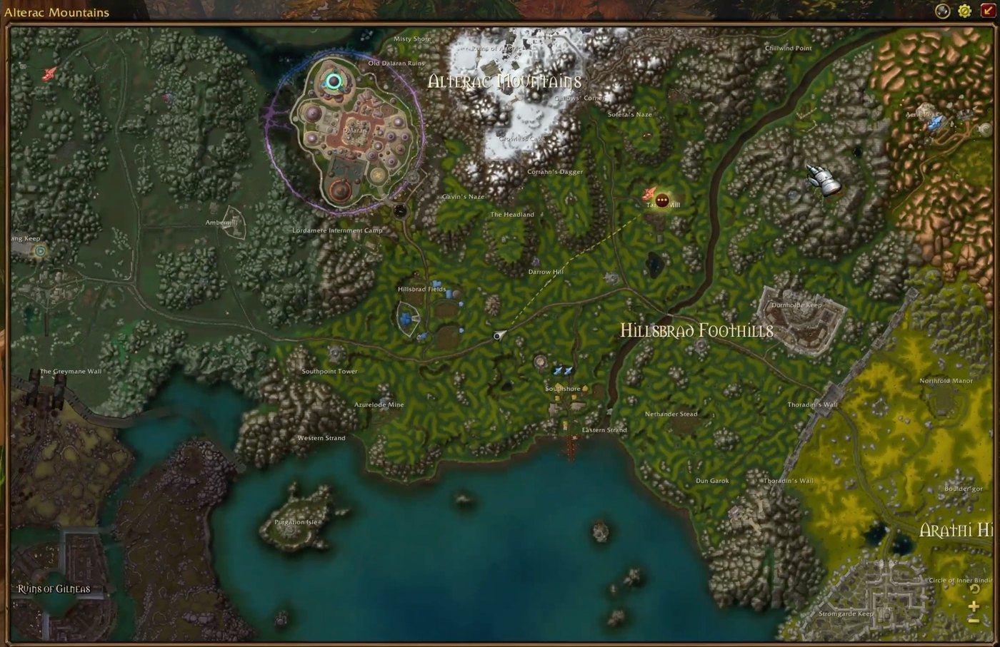
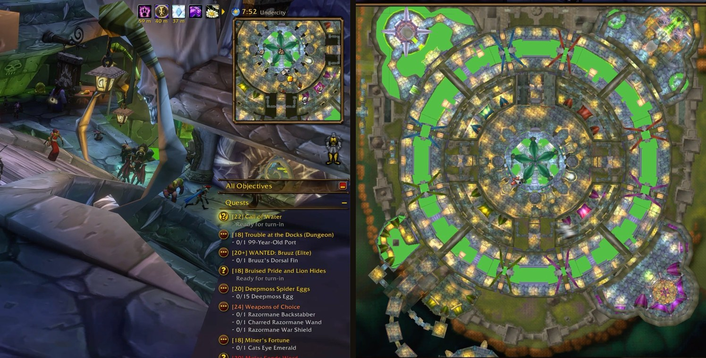

# MagicMap

A minimap that zooms out to the whole continent. Free, for WoW Forever.

**[Download](https://github.com/benmills/MagicMap/releases/latest)** ·
**[CurseForge](https://www.curseforge.com/wow/addons/magic-map)** ·
**[Try it in your browser](https://magic-map-outdoor.exe.xyz)**

*26 seconds of 3.1 in game: click to watch on YouTube.*

## What you get

- **Scroll out from your feet to all of Kalimdor**, in your minimap's corner. Press M to make it big. Left
  alone, the small map goes back to you at your default zoom; pin it to keep a view.
- **Any size, any shape.** Drag its corner: a tall tower, a strip across the top of the screen, or tiny.
  Lock it in place once it's where you want it.
- **Blizzard's own blips over the map.** Herbs, ore, mailboxes, trainers and quest givers, as Blizzard's minimap
  draws them, centred on you and sized to the zoom. Rares you've seen stay on the map for all your characters.
- **Quests on the map.** The quests you're on with their objective areas, a `!` where you can pick one up and a
  gold `?` where you hand one in, and a tooltip with what's left to do and who takes it in. On offer in Settings:
  each quest's name and progress under its pin, and a quest pill saying how far along you are and how far away.
- **Click any icon: Track or Path to.** A flight master, quest giver or rare: Track points Blizzard's gold arrow
  along the way you'd walk (or draws the line, or both); Path to draws that walk around cliffs and water and keeps
  you both in view. Yards and minutes either way.
- **The time of day.** The map takes on the game's own light where you stand: warm at dawn and dusk, cool and
  dimmer at night.
- **Floor plans indoors.** Undercity, Ironforge and caves show the floor you're on.
- **Gathering made easy.** Find Herbs or Find Minerals turns itself back on after you die or log in.
- **Your minimap's buttons, without the clutter.** Addon buttons, the calendar and the clock are behind
  one AddOns button by the gear, and the title shows what you pick: zone, coordinates, the time, day or night.
- **Every kind of pin yours to tune.** Settings > Pins lists each one the map draws, with its icon: hide it,
  size it, fade it or pick another of Blizzard's icons for it, for all pins, a family or one kind.
- **Works with Questie, HandyNotes and GatherMate.** Their pins show on the map, never twice. No other
  addon is needed: the quest data is built in.

 

[Every feature](docs/features.md).

## Install

1. Get `MagicMap-v3.2.0.zip` from the [latest release](https://github.com/benmills/MagicMap/releases/latest),
   or install from [CurseForge](https://www.curseforge.com/wow/addons/magic-map).
2. Unzip it into `World of Warcraft/_forever_/Interface/AddOns/`. Updating from 1.x? Delete the old
   `MagicMap` folder first.
3. Restart the game, then click the minimap button. It asks what to replace: the minimap, the world map,
   both or neither.

## Controls

| | |
| --- | --- |
| Zoom, pan | Mouse wheel or + / −; drag |
| Big map | M |
| Track a quest or icon | Click it, then Track (or Path to, for the line); click it again for Stop tracking |
| Keep a view | The pin above the reset arrow (till you click it again, Track or reload) |
| Move, lock | Drag the border or Alt-drag the map; Settings > General > Lock window |
| Waypoint | Ctrl-click; right-click for more |
| Settings | The gear, or `/mm settings` |
| Back to Blizzard's minimap | `/mm` (again to switch back); `/mm help` for the rest |

## Limits

- WoW Forever only, English client, build 1.60.1.70938.
- No arrow in dungeons and raids (the game hides your position there).
- Blizzard's blips (herbs, ore, mailboxes...) show only around you, as on Blizzard's minimap: not on the
  big map, not while a path's line is drawn, and not zoomed out past its widest. Their tooltips are
  Blizzard's own: since build 1.60.1.70938 the game keeps their names from addons.
- M in combat opens Blizzard's world map (ours can't open then).
- May conflict with other minimap addons such as SexyMap. [More](docs/features.md#limits-in-detail).

**Found a bug?** Type `/mm mark <what you saw>` when it happens, then
[open an issue](https://github.com/benmills/MagicMap/issues) with a screenshot.

## AI-repainted map art

Sixteen broken patches of Blizzard's map art (flat, unfinished blocks) are repainted using AI image
generation from the art around them. Everything else is the game's own art. Turn it off in Settings >
Map > "Repair broken map art".

## For developers

    python3 -m venv .venv && .venv/bin/pip install -r tools/requirements-dev.txt
    tools/check.sh                       # lint and every test, as CI runs them
    .venv/bin/python tools/install.py    # install into your WoW Forever client

How it's built: [architecture.md](architecture.md). Data, the simulator and releases:
[docs/development.md](docs/development.md).

## License

GPLv3 ([LICENSE](LICENSE)). Quest, NPC and item data comes from
[QuestieDB](https://github.com/Questie/QuestieDB) and [Questie](https://github.com/Questie/Questie),
with thanks ([NOTICE.md](NOTICE.md)). The repainted map art isn't under the GPLv3 (see NOTICE.md).
Not affiliated with Blizzard Entertainment or Questie.
