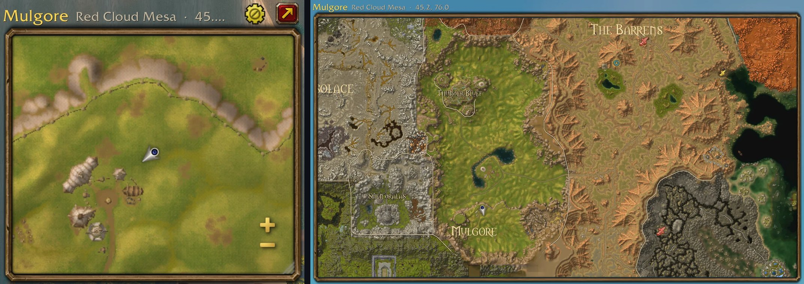
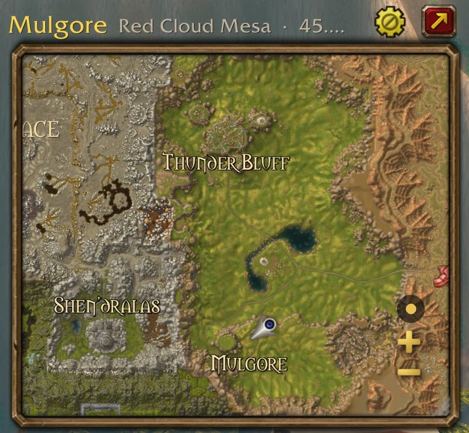
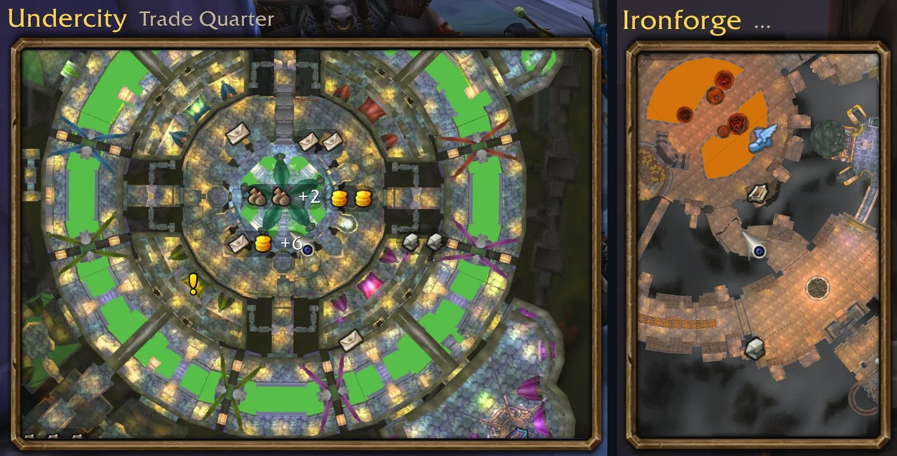
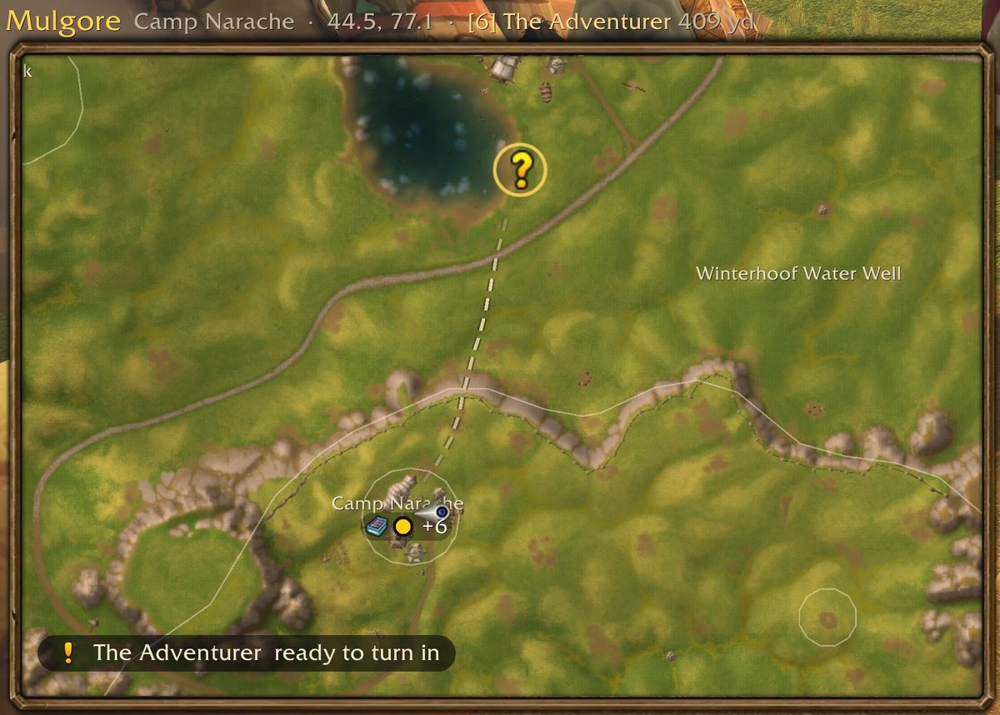
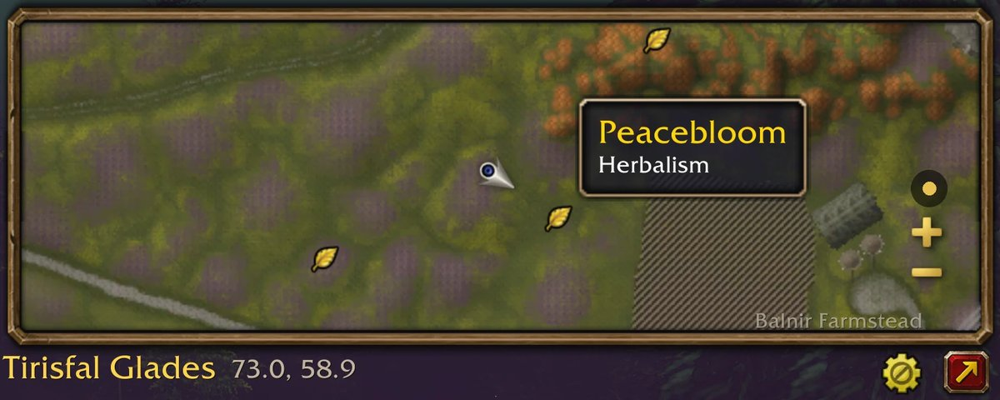

# MagicMap

**One map for all of Azeroth, right where your minimap is.** Zoom out from the street you're on to the
whole continent, see inside cities and caves, and always know where your next quest, herb or flight
master is. Press M and the same map grows into a big map.

For **WoW Forever**. Free and open source (GPLv3). [Download the latest release](https://github.com/benmills/MagicMap/releases/latest).

## Why players use it

**A minimap that zooms out.** Blizzard's minimap stops at a few hundred yards. MagicMap draws the game's
own terrain at any zoom, from your feet to a whole continent, with zone names and borders to find your
way. Drag to look around; a moment later it glides back to you.

**See inside cities, caves and buildings.** Indoors, the map shows Blizzard's own floor plans in place:
the floor you're on in full, the levels above and below faded, so you never lose track in Undercity
or Ironforge. On the big map, a capital shows all its buildings at once, with its districts named.

**Quests at a glance.** Your quests with their progress, objective areas as the game draws them, quests
to pick up, and a tooltip with the mobs, items and who to turn in to. Click a quest to follow it and a
hand-drawn line walks you there, around cliffs, water and lava.

**Everything Blizzard's minimap tracks, at any zoom.** Herbs, ore, mailboxes, trainers and other
services keep their icons and tooltips however far you zoom out, and the map remembers the ones you've
passed. Rares you've seen are remembered for every character.

**Tidy and familiar.** Blizzard's own art and icons, crowded icons grouped into a small pill you can
open, flight points, dungeons and your party on the map, and pins from Questie, HandyNotes and
GatherMate where you'd expect them. Everything can be switched on or off from the gear menu.

**Light and safe.** The map does its work in small slices so the game stays smooth, catches its own
errors without breaking, and gives Blizzard's minimap back exactly as it was when you turn it off.

[Every feature in detail](docs/features.md).

## Install

1. Download `MagicMap-v2.0.0.zip` from the [latest release](https://github.com/benmills/MagicMap/releases/latest).
2. Unzip it into `World of Warcraft/_classic_beta_/Interface/AddOns/`, so you have
   `Interface/AddOns/MagicMap/MagicMap.toc`. Updating from 1.x: delete the old `MagicMap` folder first.
3. Restart the game (a `/reload` isn't enough the first time) and tick MagicMap in the AddOns list.

You don't need any other addon: the quest data is built in.

## Using it

| | |
| --- | --- |
| **Zoom, pan** | Mouse wheel or + / −; drag the map. Reset (above +) goes back to the default zoom. |
| **Big map** | M or the red button; M or Escape to shrink. |
| **Follow a quest** | Click its pin; the quest line at the bottom left shows its progress. |
| **Waypoint** | Ctrl-click the map; right-click for more. |
| **Settings** | The gear by the zone name. |
| **Commands** | `/mm` swaps MagicMap and Blizzard's minimap; `/mm help` lists the rest. |

**Limits:** WoW Forever only (English clients), on the game build it was made for. Instances hide your
position, so they're shown without your arrow. Blizzard's blips are only seen within about 230 yards.
Other minimap addons (SexyMap and the like) may conflict. [More](docs/features.md#limits-in-detail).

**Found a problem?** Type `/mm mark <what you saw>` the moment it happens, then
[open an issue](https://github.com/benmills/MagicMap/issues) with a screenshot. For a deeper look,
attach `WTF/Account/<your account>/SavedVariables/MagicMap.lua` after a `/reload`. Nothing leaves
your computer otherwise.

# How it works

MagicMap is a World of Warcraft addon (Lua) built on facts prepared offline, and on what the game
tells it while you play:

- **Atlas, the facts** (`atlas/`, `Data/`). Offline tools in `tools/` read the game client's own files
  and bake what never changes into Lua data: the minimap terrain tiles' IDs, zone borders and labels, a
  walkable grid for routes, flight points and places, and every building's indoor minimap pictures,
  placed from its 3D model ([ADR 0008](docs/decisions/0008-interiors.md)). Quest, NPC and item facts
  come from QuestieDB. At runtime the addon only draws the game's own textures by file ID.
- **Game, the senses** (`game/`). Blizzard's minimap keeps running out of sight as a sensor: MagicMap
  reads its blips (herbs, services, quest givers) and turns them into its own pins. It reads your
  position, quests and party, works out which building room you're in from your position and subzone,
  and borrows other addons' pins.
- **Model and UI** (`model/`, `ui/`). Model decides what matters (your target, the walking route, what's
  remembered); UI draws it with a small engine that lays out each layer in timed slices off the frame,
  so zooming and panning stay smooth.

Each part may only reach the others through a narrow, checked boundary
([architecture.md](architecture.md), [docs/structure.md](docs/structure.md)). A headless simulator of
the WoW client runs the addon in CI: every command, replays of past bugs, and frame-time budgets
priced from real client measurements.

## Development

    python3 -m venv .venv && .venv/bin/pip install -r tools/requirements-dev.txt
    tools/check.sh                       # lint and every test, as CI runs them
    .venv/bin/python tools/install.py    # install into your WoW Forever client
    .venv/bin/python tools/sim.py --help # drive the simulated client

Regenerating the data, telemetry, the simulator, the release steps and the architecture rules:
[docs/development.md](docs/development.md).

## License and credits

MagicMap is free software under the GNU General Public License, version 3 ([LICENSE](LICENSE)). Its
quest, NPC, object and item data is derived from [QuestieDB](https://github.com/Questie/QuestieDB) and
[Questie](https://github.com/Questie/Questie), used under the GPLv3 terms they extend to copies of
their work, with thanks to their authors and contributors ([NOTICE.md](NOTICE.md)). MagicMap isn't
affiliated with Questie or Blizzard Entertainment.
