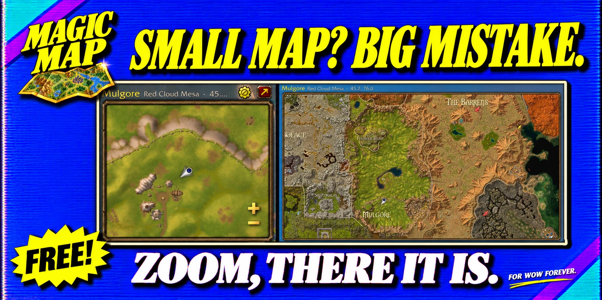
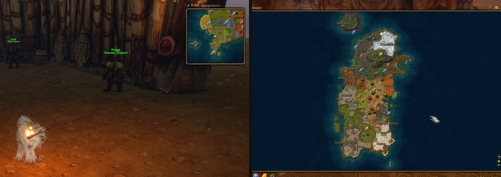
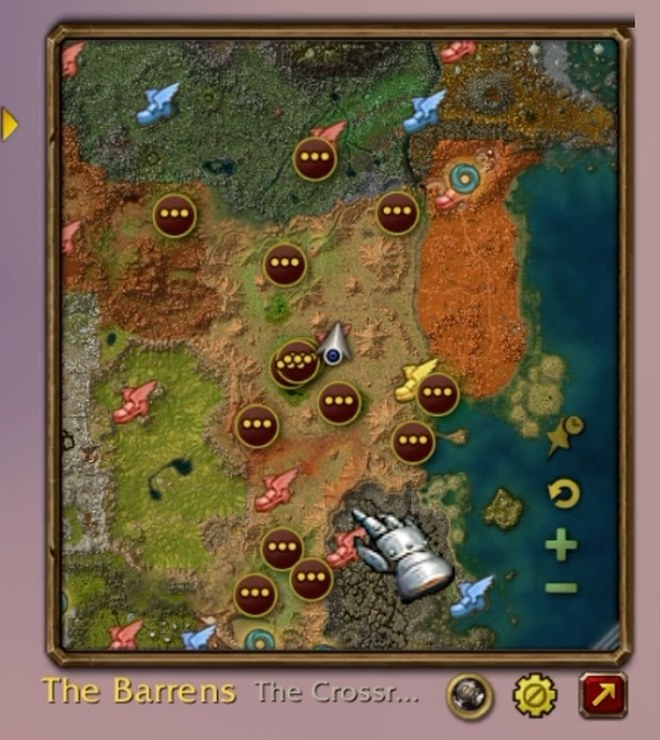
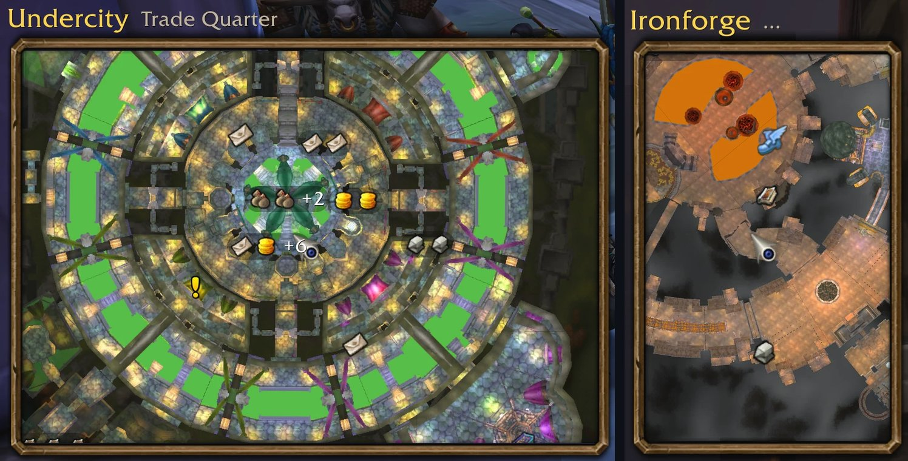
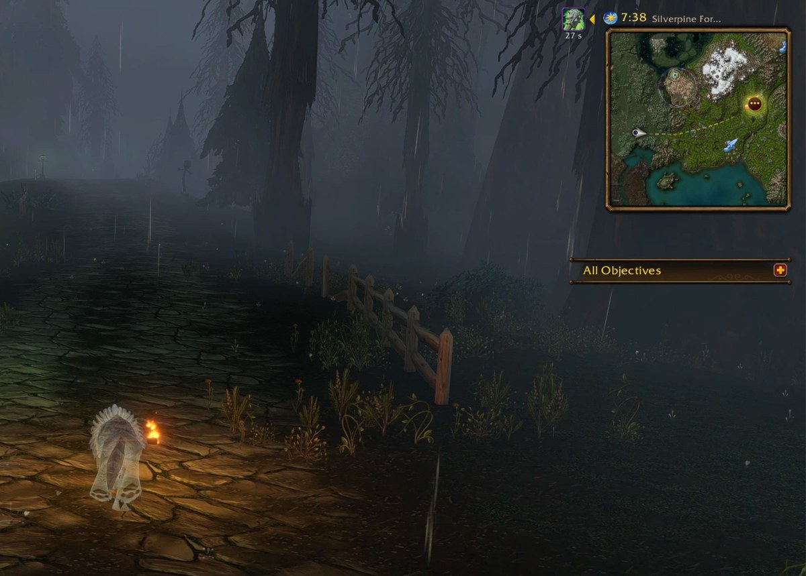

# MagicMap

A minimap that zooms out to the whole continent. Free, for WoW Forever.

**[Download](https://github.com/benmills/MagicMap/releases/latest)** ·
**[CurseForge](https://www.curseforge.com/wow/addons/magic-map)** ·
**[Try it in your browser](https://magic-map-outdoor.exe.xyz)**

<!-- TODO(#9): refreshed hero, the minimap and the big map with no zone borders and the ocean -->

## What you get

- **Scroll out from your feet to all of Kalimdor**, in your minimap's spot. Press M to make it big.
- **Floor plans indoors.** Undercity, Ironforge and caves show the floor you're on.
- **Quests on the map.** The quests you're on with their objective areas, and a tooltip with what's left
  to do and the turn-in; on the big map each quest's name under its pin. Track one and a gold arrow shows
  the way; the quest pill at the bottom says how far along you are and how far away.
- **Click any icon: Track or Path to.** A flight master, quest giver or rare: Track points Blizzard's gold arrow
  along the way you'd walk; Path to draws that walk around cliffs and water and keeps you both in view. Yards
  and minutes either way.
- **Blizzard's own blips over the map**: herbs, ore, mailboxes, trainers and quest givers as Blizzard's
  minimap draws them, with richer tooltips: a herb's or ore's skill in your skill-up colour, an NPC's title,
  and the quests they have for you. Rares you've seen stay on the map for all your characters.
- **Gathering made easy.** Find Herbs or Find Minerals turns itself back on after you die or log in.
- **Your minimap's buttons, without the clutter.** Addon buttons, the calendar and the clock are behind
  one AddOns button by the gear, and the title shows what you pick: zone, coordinates, the time, day or night.
- **Every kind of pin yours to tune.** Settings > Pins lists each one the map draws, with its icon: hide it,
  size it, fade it or pick another of Blizzard's icons for it, for all pins, a family or one kind.
- **Works with Questie, HandyNotes and GatherMate.** Their pins show on the map, never twice. No other
  addon is needed: the quest data is built in.

<!-- TODO(#9): refreshed zoomed-out minimap (no zone borders) -->

<!-- TODO(#12): refreshed followed-quest shot (no zone borders) -->

<!-- TODO(#11): screenshot, a flight master pathed to: the line framed, the yards and time pill -->
<!-- TODO(#14): screenshot, crowded icons in pills, one opened into its grid -->
<!-- TODO(#13): screenshots, the welcome's four cards and the Settings window -->
<!-- TODO(#10): GIF, wheeling out from your feet to the whole continent, then M -->

[Every feature](docs/features.md).

## Install

1. Get `MagicMap-v3.0.0.zip` from the [latest release](https://github.com/benmills/MagicMap/releases/latest),
   or install from [CurseForge](https://www.curseforge.com/wow/addons/magic-map).
2. Unzip it into `World of Warcraft/_forever_/Interface/AddOns/`. Updating from 1.x? Delete the old
   `MagicMap` folder first.
3. Restart the game, then click the minimap button. It asks what to replace: the minimap, the world map,
   both or neither.

## Controls

| | |
| --- | --- |
| Zoom, pan | Mouse wheel or + / −; drag |
| Big map | M |
| Track a quest or icon | Click it, then Track (or Path to, for the line); the pill's × stops |
| Waypoint | Ctrl-click; right-click for more |
| Settings | The gear, or `/mm settings` |
| Back to Blizzard's minimap | `/mm` (again to switch back); `/mm help` for the rest |

## Limits

- WoW Forever only, English client, build 1.60.1.70862.
- No arrow in dungeons and raids (the game hides your position there).
- Blizzard's blips (herbs, ore, mailboxes...) show only around you, as on Blizzard's minimap: not on the
  big map, not while a path's line is drawn, and not zoomed out past its widest.
- May conflict with other minimap addons such as SexyMap. [More](docs/features.md#limits-in-detail).

**Found a bug?** Type `/mm mark <what you saw>` when it happens, then
[open an issue](https://github.com/benmills/MagicMap/issues) with a screenshot.

## AI-repainted map art

A few broken patches of Blizzard's map art (flat, unfinished blocks) are repainted using AI image
generation from the art around them. Everything else is the game's own art. Turn it off in Settings >
Map > "Repair broken map art".

## For developers

    python3 -m venv .venv && .venv/bin/pip install -r tools/requirements-dev.txt
    tools/check.sh                       # lint and every test, as CI runs them
    .venv/bin/python tools/install.py    # install into your WoW Forever client

How it's built: [architecture.md](architecture.md). Data, the simulator and releases:
[docs/development.md](docs/development.md).

## License

GPLv3 ([LICENSE](LICENSE)). Quest, NPC and item data comes from
[QuestieDB](https://github.com/Questie/QuestieDB) and [Questie](https://github.com/Questie/Questie),
with thanks ([NOTICE.md](NOTICE.md)). The repainted map art isn't under the GPLv3 (see NOTICE.md).
Not affiliated with Blizzard Entertainment or Questie.
