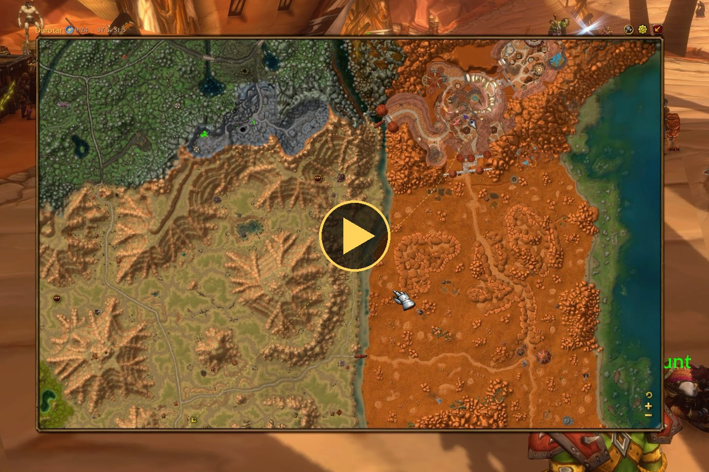

# MagicMap 3.1: CurseForge / Wago listing

Replaces dist/listing-v3.0.md. The changelog for either site is dist/RELEASE_NOTES-v3.1.0.md. The live CurseForge
page (as of 2026-11-15) still has 2.x's description and its main file is 3.0.1: paste the description below over it
whole, and upload `MagicMap-v3.1.0.zip` with the 3.1.0 notes as its changelog.

| Field | Value |
| --- | --- |
| Summary (≤ 140 characters) | A minimap that zooms out to the whole continent, any size or shape, with Blizzard's own blips. Click any icon to track it or path to it. |
| Version / file name | 3.1.0 / `MagicMap-v3.1.0.zip` |
| Game version | 1.60.1 (WoW Forever), build 1.60.1.70938 |
| Dependencies | None required. Optional: Questie, HandyNotes, GatherMate2 (HereBeDragons pins); FarmHud is yielded to |
| Video | [YouTube](https://www.youtube.com/watch?v=tdv0wxADLbg) (26 s). In CurseForge's description editor, embed it with the YouTube button (or an `<iframe src="https://www.youtube.com/embed/tdv0wxADLbg">`); the poster below links to it too |

## Gallery

Replace the 8 images on CurseForge's Gallery tab (two are the old `big-map-durotar-route` and `indoors-undercity-ironforge`, from before
3.0) with these, from `docs/images/` unless named, in this order:

1. `promo/3.1/stills/big-map-durotar-barrens.jpg` (the video's poster without its play button; not in git): Press M: the big map over Durotar and the Barrens
2. `track-path-to.jpg`: Click any icon: Track or Path to
3. `minimap-blips-orgrimmar.jpg`: Blizzard's own blips over the map, zoomed out over Orgrimmar
4. `minimap-any-shape.jpg`: Any size, any shape: a tall tower down the screen's edge
5. `big-map-hillsbrad.jpg`: The big map: zone and subzone names, and the way to a quest
6. `indoors-undercity.jpg`: Floor plans indoors
7. `quest-tooltip.jpg`: A quest's tooltip and its objective area
8. `big-map-barrens-route.jpg`: Path to: the walk around cliffs and water

## Description

**A minimap you can zoom out.** MagicMap replaces your minimap and draws the game's own terrain at any zoom, from
Blizzard's closest zoom out to a whole continent. Press M and it grows into a big map in the same frame.

For **WoW Forever** only. [Try it in your browser](https://magic-map-outdoor.exe.xyz) ·
[Every feature](https://github.com/benmills/MagicMap/blob/main/docs/features.md) · Free and open source (GPLv3)

- **See past the minimap's edge.** Wheel out to the next hub, the road, the coast. Left alone, it comes back to you
  at your default zoom; pin it to keep a view.
- **Any size, any shape.** Drag its corner: a tall tower, a strip across the top of the screen, or tiny. Drag
  its border (or Alt-drag the map) to put it anywhere, and lock it there.
- **Blizzard's own blips, on our map.** Herbs, ore, mailboxes, trainers and quest givers, drawn by Blizzard's
  minimap over ours, centred on you and sized to the zoom.
- **Quests in view.** Your quests and their objective areas as the game draws them, a `!` where you can pick one
  up and a gold `?` where you hand one in, with tooltips saying what's left and who takes it in. Names and progress
  under each pin, on the big map, the small map or both, if you want them.
- **Click any icon: Track or Path to.** Track points Blizzard's gold arrow along the way you'd walk (or draws the
  line, or both); Path to draws a line around cliffs and water and keeps you both in view.
- **The time of day.** The map takes on the game's own light where you stand: warm at dawn and dusk, cool and
  dimmer at night.
- **Floor plans indoors.** Undercity, Ironforge and caves show the floor you're on.
- **Your addons come along.** Questie, HandyNotes and GatherMate pins show on it, never twice. Your minimap's addon
  buttons, calendar and clock sit behind one AddOns button.
- **Choose what it replaces:** your minimap, the world map, both or neither. A Settings window tunes the look, live,
  down to each kind of pin.
- **Rares you've seen**, remembered for every character; party and raid; flight points, dungeons, graveyards;
  waypoints and `/way` links. Find Herbs or Find Minerals turns itself back on after you die or log in.

`/mm` swaps it with Blizzard's minimap; `/mm help` lists every command.

**Limits:** WoW Forever only, English clients. Blizzard's blips show only around you, as on its minimap: not on
the big map, not while a path's line is drawn, not zoomed out past its widest; their tooltips are Blizzard's own
(since build 1.60.1.70938 the game keeps their names from addons). North up always. Other minimap addons (SexyMap,
ElvUI's minimap) may conflict.

**AI-repainted map art:** some clearly broken parts of the game's map art, flat unfinished blocks, are patched with
repaints made using AI image generation from the surrounding game art. It's a setting, on by default ("Repair
broken map art", under Map in Settings); off, or on a game build they weren't made for, you see Blizzard's map as it is.
