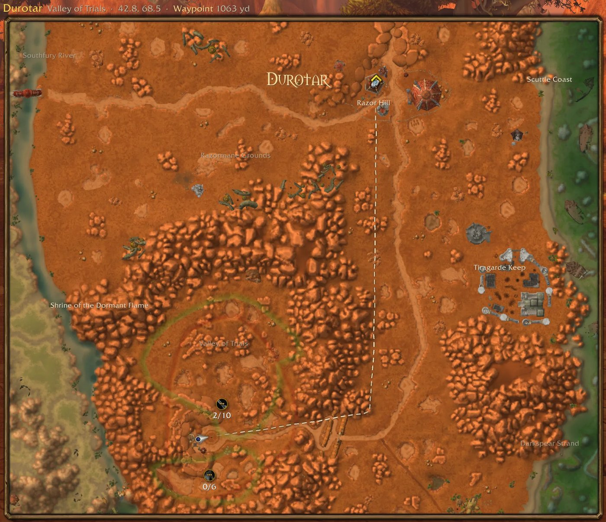
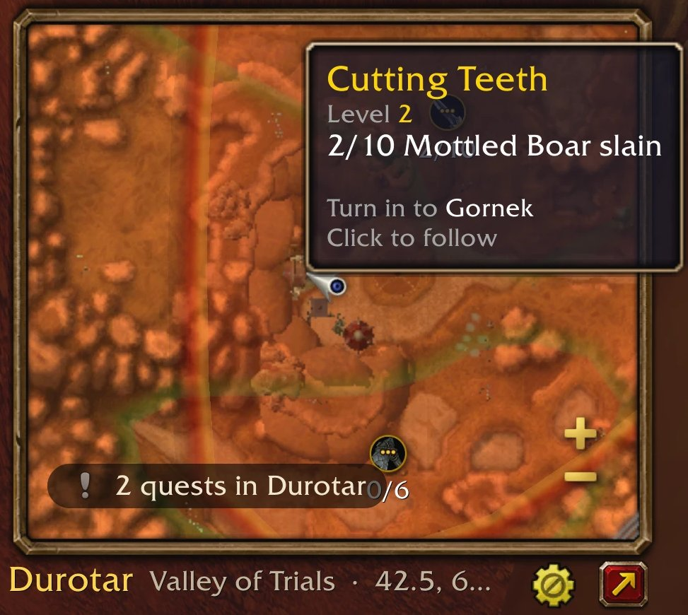

# MagicMap: every feature

The full reference behind the [README](../README.md).

## What it does

**The minimap.** It sits square on your minimap's spot, about 200 yards across, in a metal frame
whose buttons show while you hover. The wheel or + / − zoom it, every notch a step, and the reset
button above + (shown while you're off the default zoom) glides back to it; drag to pan, and left
alone for 6 seconds after a pan it glides back to you (Follow you, in Settings). Move it by the
zone name or the border (or Alt-drag the map), resize it by the corner (it keeps the yards across),
and `/mm reset` puts it back. `/mm`, the rim button or the addon compartment swaps it for
Blizzard's minimap, and back.

*The same minimap zoomed out to all of Mulgore, the hover buttons showing: the gear and the big-map
button by the zone name, reset, + and − on the right.*

**The big map (M).** M or the red button grows it into a big map, centred on you; M, the button
or Escape shrinks it. The quest log (L) still opens Blizzard's map. Click the zone name to pick a
continent, another map or an instance; with several zones in view, hover one to light it and click
to fly there. `/mm map` and `/mm zone` do the same by name.

*Durotar on the big map: the subzone names, the Valley of Trials' quest areas and pins with their
counts, and the walking line up to a waypoint at Razor Hill, its distance in the title.*

**The ground.** The game's minimap tiles at any zoom, as Blizzard drew them, on each map's own dark
water; zone and subzone names, and on the big map the zone borders traced from the terrain; your
arrow.

**Indoors.** In a building, Blizzard's own indoor minimap pictures, placed on our map over the
dimmed terrain: the rooms on your floor whole, the floors below faded and those above ghosted where
they overlap yours, the room you're in on top. Your pins, zoom and pan work as outdoors. **City
maps** (gear → Map, on): on the big map in a capital (Ironforge, Orgrimmar, Undercity...), every
building of the city at once, indoors or out, what's underground faded, with the city's own area
names (The Great Forge, the Cleft of Shadow...) among the subzone names.

*Indoors: Undercity's Trade Quarter with its services (grouped into `+2` and `+6` pills), and the
Great Forge in Ironforge by the flight master.*

**Blizzard's blips.** Outdoors Blizzard's Minimap stays out of sight and is read as a sensor:
herbs, ore, the mailbox and tracked NPCs within about 230 yards get a pin with Blizzard's tracking
icon and tooltip, at any zoom. Zoomed in to town scale, the town services you track show too, and
blips seen before (up to 5000 a continent). Blizzard's own flight, quest and POI tracking is
switched off while MagicMap draws those itself, and put back when it stops, even after a crash.

*Herbs in Tirisfal Glades: Blizzard's Peacebloom blips as pins, with their tooltip, in a wide
minimap.*

**Quests.** The quests in your log in Blizzard's icons, with their objective icon and count, in
their difficulty colour; quests to pick up; a tooltip with the quest's facts, mobs, items and who
to turn it in to. Objective areas are drawn as the game draws them, and hovering an area lights it.
Click a quest (or its area, zoomed in) to follow it: it becomes the game's tracked quest. The quest
line at the bottom left shows the quest you follow and its progress, else how many of your quests
are in this zone.

*A quest's tooltip in the Valley of Trials: its level, the objective's count, who to turn it in to.
The quest line at the bottom left counts the quests in Durotar.*

**Where to go.** Your target is your corpse while you're a ghost, else the quest you follow, else
your waypoint. A hand-inked line walks you to it around cliffs, lava and water, to a quest area's
nearest edge; off the map, a gold arrow on the edge points the way. Ctrl-click sets the game's
waypoint (Ctrl-right-click clears it), Shift-click opens chat with a `/way` line, and right-click
offers both. On the big map, right-click leads with what's there: zone, subzones, coordinates, level
range against yours, distance, quests, explored or not, and the landmarks nearby.

*Following The Adventurer at Camp Narache: the line to the turn-in's `?`, the distance in the title,
"ready to turn in" in the quest line.*

**Places and people.** Flight points, dungeon entrances, graveyards and points of interest; party and
raid members in class colours; rares you've seen, remembered for every character on your account;
the rares and treasures the game shows now; your corpse and waypoint.

**Crowded icons.** Where icons overlap they group into a small pill of up to three icons (`+N` for
the rest); click it for a grid of them all, each with its own tooltip and click (Settings: Group
overlapping icons; its tunables under Advanced).

**Other addons.** World-map pins added through HereBeDragons (Questie, HandyNotes...) show on the
map with their own icons, tooltips and clicks, each addon a row in the gear's Other addons; their
minimap pins (GatherMate...) show around you. Nothing is drawn twice.

**The gear menu** (by the zone name): the layers by group, each row with its icon and an "All" box
on top: Map (zone labels, zone borders, City maps), Quests, Places, Nearby (rares and treasures,
party and raid, then Blizzard's tracking types), Other addons. Then Use Blizzard's minimap and Reset
to defaults, then Settings: Follow you, Group overlapping icons, Minimap button, Reset window
position, Advanced (diagnostics, grouping, performance). Settings are account-wide.

## Commands

| Command (`/mm` or `/magicmap`) | Does |
| --- | --- |
| `/mm` | MagicMap or Blizzard's minimap |
| `/mm follow` | Follow you, or stop |
| `/mm map <name or id>`, `/mm zone <name>` | Show a map (alone: list them); fly to a zone |
| `/mm reset` | Back onto the minimap's spot, at its size |
| `/mm layers`, `/mm layer <name>` | What's drawn; show or hide one layer |
| `/mm icon` | The minimap button |
| `/mm mark <note>` | Note something for the bug report (saved at `/reload` or logout) |
| `/mm landmarks`, `/mm indoor`, `/mm blips` | Rares remembered; the building and room you're in; what the sensor knows |
| `/mm help` | Every command, the diagnostics too (`perf`, `errors`, `check`...) |

## Limits in detail

- **WoW Forever only**, the client build `Data/` was generated from (a patch means regenerating).
- **Blizzard's blips** are sensed only within about 230 yards of you.
- **Indoors** only buildings with Blizzard's indoor minimap pictures get them; elsewhere the terrain.
- **Instances** that hide your position are shown whole, without the arrow, line or blips.
- **Rotate Minimap**: MagicMap stays north up, and other addons' minimap pins hide while it's on.
- **Other minimap addons** (SexyMap, square-minimap addons) may conflict. While FarmHud has the
  minimap, MagicMap leaves it to FarmHud.
- **enUS** names only; no routes beyond walking; no per-character profiles
  ([v1-non-goals.md](v1-non-goals.md)).

