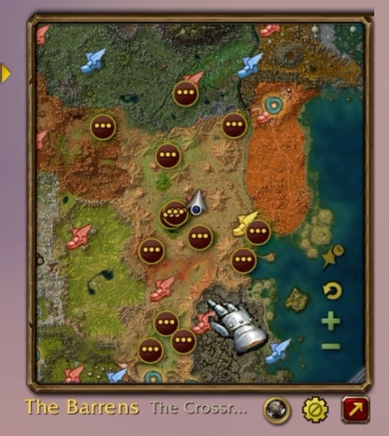
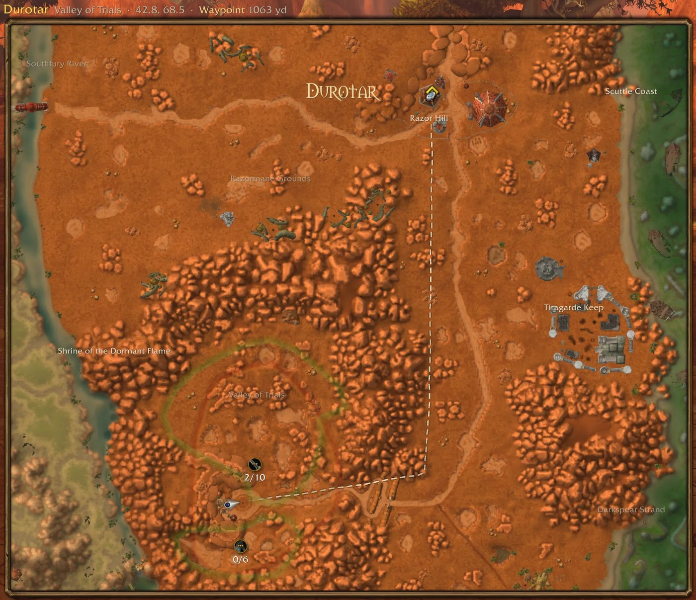
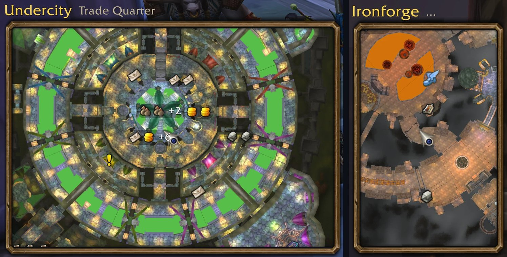
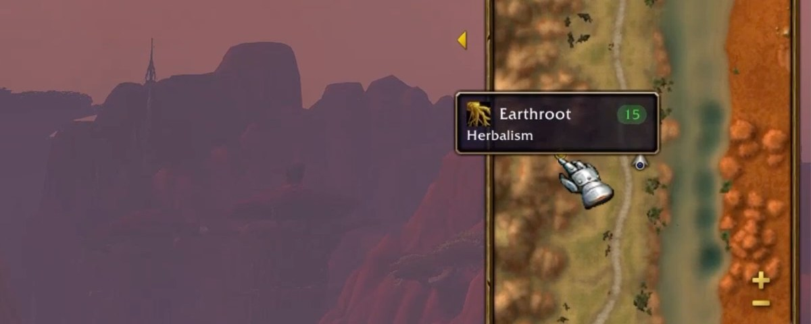
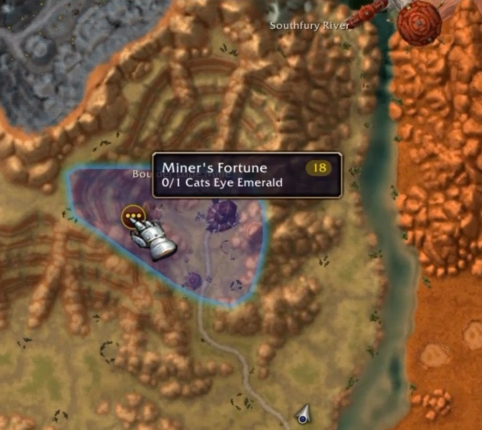
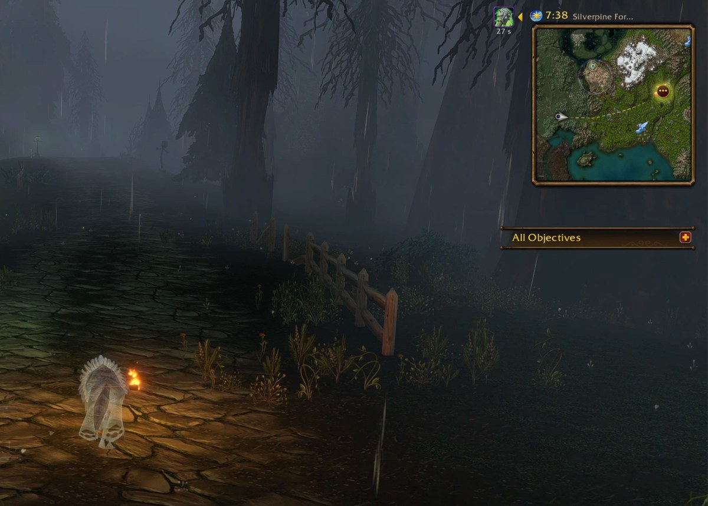

# MagicMap: every feature

The full reference behind the [README](../README.md).

## What it does

**What MagicMap replaces.** The first time you open it (the minimap button, the addon compartment or
`/mm`) a welcome asks what MagicMap should take over, as four cards: **minimap and world map**
(recommended), **minimap only**, **world map only**, or **neither**, opened from the button alone.
Continue saves the choice and opens the map as it says; Escape saves nothing and asks again next
time. Until you answer, nothing of Blizzard's is touched. The choice is two switches in Settings >
General (Replace minimap, Replace world map), live, any time; `/mm welcome` shows the welcome again.
Players who had 2.0 keep their setup (migrated to both, no welcome).

- *Minimap replaced:* our small map sits on the minimap's spot from login.
- *Minimap not replaced:* Blizzard's minimap stays, and our map is never small: it opens big, and
  closing it hides it. Blizzard's Minimap is still read, unseen, as the blips' sensor while our map is shown.
- *World map replaced:* M opens our big map. Not replaced: M is Blizzard's world map, as always.
- *Neither:* nothing of Blizzard's is touched; the minimap button, the addon compartment and `/mm`
  open and close our big map as a window of its own.

**The minimap.** It sits square on your minimap's spot, about 200 yards across, in a metal frame
whose buttons show while you hover. The wheel or + / − zoom it, every notch a step, and the reset
button above + (shown while you're off the default zoom) glides back to it; drag to pan, and left
alone for 6 seconds after a pan it glides back to you (Follow you, in Settings). Move it by the
zone name or the border (or Alt-drag the map), resize it by the corner (it keeps the yards across),
and `/mm reset` puts it back. `/mm`, the rim button or the addon compartment swaps it for
Blizzard's minimap, and back (with the minimap replaced). The minimap button is drawn as other
addons' buttons are (LibDBIcon's shape), draggable round the rim.

<!-- TODO(#9): refreshed screenshot (2.1.0: no zone borders, current tooltip) -->

*The same minimap zoomed out to all of Mulgore, the hover buttons showing: the gear and the big-map
button by the zone name, reset, + and − on the right.*

**The big map (M).** M or the red button grows it into a big map, centred on you; M, the button
or Escape shrinks it. The quest log (L) still opens Blizzard's map (so does M, with Replace world
map off in Settings). Click the zone name to pick a
continent, another map or an instance; with several zones in view, hover one to light it and click
to fly there. `/mm map` and `/mm zone` do the same by name.

*Durotar on the big map: the subzone names, the Valley of Trials' quest areas and pins with their
counts, and the walking line up to a waypoint at Razor Hill.*

**The ground.** The game's minimap tiles at any zoom, as Blizzard drew them, on each map's own dark
backdrop; zone and subzone names (no zone borders: [ADR 0012](decisions/0012-no-borders.md)); your arrow, with a denser shadow. Under the tiles, a one-picture stand-in for each continent
(Eastern Kingdoms, Kalimdor: zone colours, a crisp coast) shows through wherever the tiles aren't
there yet, so a fast zoom out or a flick never shows bare backdrop. It's never switched over to:
the tiles are the map at every zoom. **The ocean** (Settings > Map > Ocean, on): a coloured sea round
the Eastern Kingdoms, Kalimdor and Zephras Isle, where Blizzard's water is near-black, and the same deep
colour past it. **Map art repairs** (Settings > Map > Repair broken map art, on):
16 places where Blizzard's art is broken, flat unfinished blocks and straight joins in shallow water, are
patched with repaints made with AI image generation from the art round them. Everything else in the tiles
stays the game's own. Off, or on a game build they weren't made for, you see Blizzard's map as it is
([NOTICE.md](../NOTICE.md), [ADR 0011](decisions/0011-ai-map-art.md)).

**Indoors.** In a building, Blizzard's own indoor minimap pictures, placed on our map over the
terrain (dimmed on the small map): the rooms on your floor whole, the floors below faded and those above
ghosted where they overlap yours, the room you're in on top. Your pins, zoom and pan work as outdoors; a
small building (a house, an inn) zooms the small map all the way in as you walk in, and back out as you
leave (Settings > Map > Indoor auto-zoom). The big map has no dimming veil over the terrain. **City
maps** (gear → Map, on): on the big map in a capital (Ironforge, Orgrimmar, Undercity...), every
building of the city at once, indoors or out, what's underground faded, with the city's own area
names (The Great Forge, the Cleft of Shadow...) among the subzone names.

*Indoors: Undercity's Trade Quarter with its services (grouped into `+2` and `+6` pills), and the
Great Forge in Ironforge by the flight master.*

**Blizzard's blips.** Outdoors Blizzard's Minimap stays out of sight and is read as a sensor:
herbs, ore, the mailbox and tracked NPCs within about 230 yards get a pin with Blizzard's tracking
icon and tooltip, at any zoom. Herbs and ore show while they're in range, as on Blizzard's minimap.
Zoomed in to town scale, the town services you track show too, and the mailboxes and services you've
passed (remembered, up to 5000 a continent), each marked "Not in sight" while out of range. Blizzard's own flight, quest and POI tracking is
switched off while MagicMap draws those itself, and put back when it stops, even after a crash.

*Herbs in Tirisfal Glades: Blizzard's Peacebloom blips as pins, with their tooltip, in a wide
minimap.*

**Quests.** The quests in your log in Blizzard's icons, with their objective icon and count, in
their difficulty colour; quests to pick up; a tooltip with the quest's facts, mobs, items and who
to turn it in to. Objective areas are drawn as the game draws them (its edges and fills); the quest you follow is filled, the rest a quiet edge; hovering an area lifts it gently.
The fills, edges and hover are adjustable in Settings > Quest areas. The tooltip is compact: one row of
facts with the level in its difficulty colour, a `?` icon before who takes the quest in.
Click a quest (or its area, zoomed in) to follow it: it becomes the game's tracked quest. The quest
pill at the bottom left shows the quest you follow and its progress, else how many of your quests
are in this zone. A sensed quest-giver's `!` (or `?`) shows only while you still have an offer (or a
quest to hand in) there, so it goes as soon as you accept.

<!-- TODO(#12): refreshed screenshot (2.1.0: no zone borders, current tooltip) -->

*A quest's tooltip in the Valley of Trials: its level, the objective's count, who to turn it in to.
The quest pill at the bottom left counts the quests in Durotar.*

**Where to go.** Your target is your corpse while you're a ghost, else the quest you follow, else
your waypoint. A thin, quiet gold dashed line walks you to it around cliffs, lava
and water, leaving your arrow on a lazy lead-in and turning corners in rounded bends, to a quest
area's nearest edge; off the map, a gold arrow on the edge points the way. The line's style (dotted,
dashed, solid), weight, colour, glow, breathing, opacity and outline are in Settings > Tracking line.
**Click any icon to track it**: a click, left or right, opens the icon's menu: Track (Stop tracking while
it's the tracked one), then the map's rows (Clear waypoint, Follow me). Track sets the game's waypoint at
the icon, which wears the focus ring, and the line and the title go to it; what you track is never grouped
into a pill and shows at any zoom. A quest icon's rows are "Track quest" (it follows the quest) and "Open in
quest log". While you follow a quest, the quest pill is its icon: hover it for the quest's tooltip, click it
for its menu (Stop tracking is one click away). Ctrl-click sets the game's waypoint (Ctrl-right-click clears
it), Shift-click opens chat with a `/way` line, and right-click off an icon offers both. A tracking pill at the top left of the map gives the yards along the route to the
target and a plain ETA at your pace. On the big map, right-click leads with what's there: zone, subzones, coordinates, level
range against yours, distance, quests, explored or not, and the landmarks nearby.

<!-- TODO(#12): refreshed screenshot (2.1.0: no zone borders, current tooltip) -->

*Following The Adventurer at Camp Narache: the line to the turn-in's `?`,
"ready to turn in" in the quest pill.*

**Places and people.** Flight points, dungeon entrances, points of interest and graveyards (off until
you turn them on in the gear menu); party and
raid members in class colours; rares you've seen, remembered for every character on your account;
the rares and treasures the game shows now; your corpse and waypoint.

**Crowded icons.** Where icons overlap they group into a small pill of up to two icons (`+N` for
the rest, sized to its digits); click it for a grid of them all, each with its own tooltip and click
(Settings > General > Group icons; its tunables under Settings > Grouping).

**Other addons.** World-map pins added through HereBeDragons (Questie, HandyNotes...) show on the
map with their own icons, tooltips and clicks, each addon a row in the gear's Other addons; their
minimap pins (GatherMate...) show around you. Nothing is drawn twice.

**The gear menu** (by the zone name): the layers by group, each row with its icon, an "All" box
on top and the n/total shown in the group's name: Map (zone labels, City maps), Quests,
Places, Nearby (rares and treasures, party and raid, then Blizzard's tracking types), Other addons.
Then Use Blizzard's minimap (while ours replaces it; Blizzard's logo on the row) and Reset to defaults,
then Settings.

**Settings.** A window of its own (the gear's Settings, `/mm feel` or `/mm settings`, or Game menu >
Options > AddOns > MagicMap > Open MagicMap Settings), a sidebar of categories with the page of the
chosen one beside it (the last is remembered). Every change applies at once; each page has its own
Reset (General and Diagnostics are switches and actions, so none), and Reset all at the bottom.
Settings are account-wide.

| Page | Settings (default) |
| --- | --- |
| General | Replace minimap, Replace world map (what the welcome chose); Follow you (on); Minimap button (on); Group icons (on); Reset window position |
| Map | Label size (100%); Subzone size (100%); Subzone opacity (60%); Your arrow's size (100%); Indoor dimming (65%); Indoor auto-zoom (on); Ocean (on); Repair broken map art (on) |
| Info pills | Backing (25%); Size (100%); Quest pill (quest or zone count / followed quest only / off); Quest progress (on); Fade quest pill (on: the zone count only while you point at the map); Distance pill (on); Distance shows (yards and time / yards / time); Distance corner (top left / top right); Fade distance pill (off) |
| Icons | Icon size (120%); Quest icon size (100%); Focus ring size (145%); Focus ring opacity (25%); Focus ring colour (Gold) |
| Tracking line | Style (dashed); Weight (1.0 px); Colour (Gold); Glow (off); Breathing (off); Opacity (55%); Outline (off); Outline colour (Dark) |
| Quest areas | The followed quest's fill, edge and edge width; the others' fill, edge and edge width; the hover's fill and edge (as the game draws them, a quiet fill by default) |
| Grouping | Distance (24 px); Reach (3x); Smallest group (2 icons); Icons in a pill (2); Group pill backing (35%) |
| Diagnostics | Debug info in title; Indoor maps report; Record 10 seconds; Compare with other addons; Memory breakdown (each also a `/mm` command) |

## Commands

| Command (`/mm` or `/magicmap`) | Does |
| --- | --- |
| `/mm` | MagicMap or Blizzard's minimap |
| `/mm follow` | Follow you, or stop |
| `/mm map <name or id>`, `/mm zone <name>` | Show a map (alone: list them); fly to a zone |
| `/mm reset` | Back onto the minimap's spot, at its size |
| `/mm layers`, `/mm layer <name>` | What's drawn; show or hide one layer |
| `/mm icon` | The minimap button |
| `/mm minimap ours`, `/mm minimap blizzard` | Who has the minimap while our map is shown |
| `/mm feel`, `/mm settings`, `/mm welcome` | The settings window; the first-run welcome again |
| `/mm mark <note>` | Note something for the bug report (saved at `/reload` or logout) |
| `/mm landmarks`, `/mm indoor`, `/mm blips` | Rares remembered; the building and room you're in; what the sensor knows |
| `/mm help` | Every command, the diagnostics too (`perf`, `errors`, `check`...) |

## Limits in detail

- **WoW Forever only** (installed under `World of Warcraft/_forever_/`), the client build `Data/` was
  generated from, 1.60.1.70790 (a patch means regenerating).
- **Blizzard's blips** are sensed only within about 230 yards of you.
- **Indoors** only buildings with Blizzard's indoor minimap pictures get them; elsewhere the terrain.
- **Instances** that hide your position are shown whole, without the arrow, line or blips.
- **Rotate Minimap**: MagicMap stays north up, and other addons' minimap pins hide while it's on.
- **Other minimap addons** (SexyMap, square-minimap addons) may conflict. While FarmHud has the
  minimap, MagicMap leaves it to FarmHud.
- **enUS** names only; no routes beyond walking; no per-character profiles
  ([v1-non-goals.md](v1-non-goals.md)).

